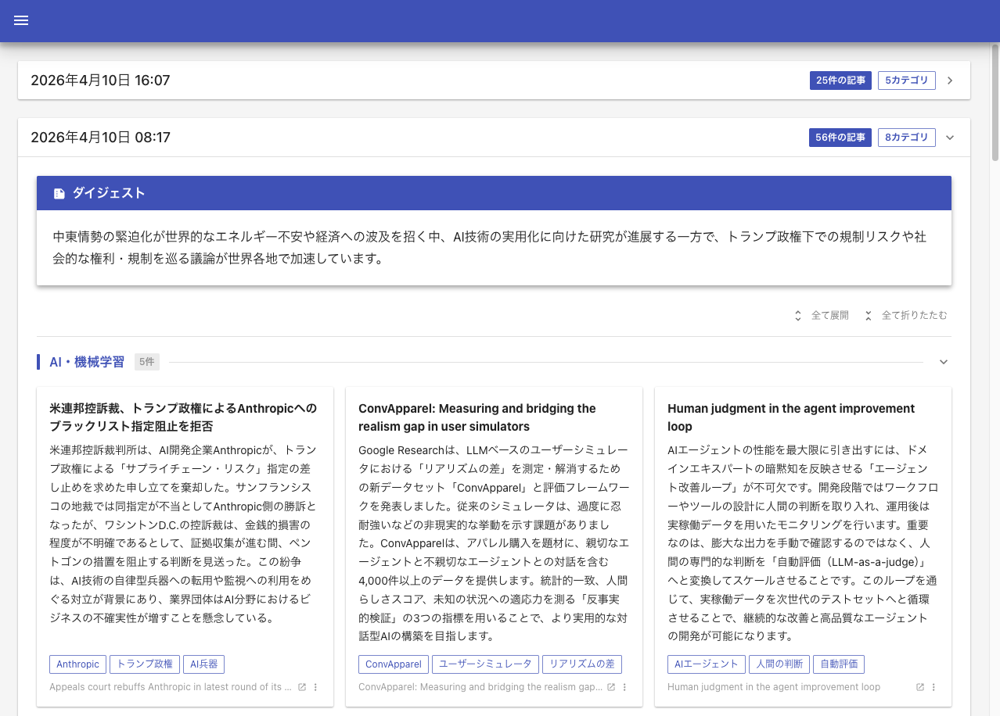

# News Viewer

AI が収集・要約したニュース記事を閲覧するための Web アプリケーション。
バッチごとに蓄積されたニュース要約を、カテゴリ別カード一覧とダイジェストとして表示します。



## 技術スタック

- **フレームワーク**: Next.js 16 (App Router, Standalone output)
- **UI**: MUI v9 (Material Design) + Emotion
- **DB**: Google Cloud Firestore（サーバー側SDK）
- **言語**: TypeScript 5 / React 19
- **コンテナ**: Docker / docker-compose

## セットアップ

### 前提条件

- Node.js 22+
- Google Cloud SDK（実環境のFirestoreを使う場合）

### ローカル開発

```bash
# 依存パッケージをインストール
npm install

# 環境変数を設定
cp .env.local.example .env.local

# 別ターミナルでFirestoreエミュレーターを起動
docker compose up firestore

# 開発サーバーを起動
npm run dev
```

http://localhost:3000 でアクセスできます。実際のFirestoreへ接続する場合は
`GOOGLE_CLOUD_PROJECT`を設定し、`gcloud auth application-default login`を実行してください。

### Docker

```bash
docker compose up --build
```

Viewerは http://localhost:3080 で起動し、同じCompose内のFirestoreエミュレーターへ接続します。

### SQLiteバックエンド

`DB_BACKEND=sqlite`と`DATABASE_URL=file:<News-Summarizerが書くSQLiteファイル>`を設定すると、
Firestoreの代わりにSQLiteを読み取り専用で読みます（Docker Composeでの自前ホスト向け）。
カテゴリ・期間の絞り込みは両バックエンドで同じように使えます。ただし**検索はキーワード一致のみ**で、
意味検索（ベクトル検索）はFirestoreバックエンドでのみ利用できます。SQLiteでは`EMBEDDING_*`を
設定しても使われず、検索画面に「キーワード一致のみ」と表示されます。

## Google Cloudへのデプロイ

Cloud Run向けのコンテナは`Dockerfile`、Cloud Build設定は`cloudbuild.yaml`にあります。
Firestore、Cloud Run、IAPを含む環境全体は、News-Summarizerリポジトリの
`infra/`からTerraformで構築します。個人・家族利用を想定し、Cloud Runは最小インスタンス数を0、
最大インスタンス数を1に制限しています。

Cloud RunではApplication Default Credentialsが自動的に使われるため、
サービスアカウント鍵ファイルをコンテナへ入れる必要はありません。

## Roadmap

以下の機能を今後実装する予定です。

- ✅ カテゴリと期間の組み合わせによる記事の絞り込み（例: テクノロジーの過去3日間）
- よく使う閲覧条件の保存と再利用
- 気になる記事を保存する「あとで読む」
- ✅ キーワード検索（保存済みベクトルによる意味検索とキーワード一致のハイブリッド。ただし意味検索は Firestore 構成のみで、`DB_BACKEND=sqlite` ではキーワード一致のみ）
- 特定キーワードを非表示にする除外設定
- ✅ 保存済みベクトルを利用し、複数の配信元による同じ話題の記事を自動でまとめて表示する機能

## 免責事項

本プロジェクトは個人の学習および自宅環境での利用を目的としたものです。
ISC ライセンスに基づき「現状のまま」提供され、動作保証やサポートは一切行いません。
利用によるデータの損失等についても責任を負いかねます。

Issue への対応は気まぐれです。

## AI 利用

本プロジェクトには Claude Code 及び Gemini CLI を使用しています。

## ライセンス

本プロジェクトは [ISC](LICENSE) ライセンスの下で公開されています。
利用しているサードパーティ製ライブラリとライセンスの一覧は、[THIRD-PARTY-NOTICES.md](THIRD-PARTY-NOTICES.md) を参照してください。

## Stable batch pagination

`/api/batches` returns an opaque `nextBefore` string. Pass it unchanged as
`before`; do not parse it as a date. New cursors contain the exact timestamp
and tie-breaking ID. SQLite orders by timestamp then numeric ID; Firestore
orders by timestamp then document ID and retains nanoseconds. Legacy ISO-date
`before` requests remain supported with their original strict timestamp cutoff.
Malformed cursors return HTTP 400. Category scanning advances using the same
keyset even when a scan window contains no matching category. No data migration
or additional Firestore composite index is required: the document-name ordering
matches the timestamp index's implicit descending document-name suffix.

Run regression tests with `node --test tests/pagination.test.cjs` after `npm ci`.
The Firestore tests use a local query double; production Firestore is not contacted.


## AI エージェント向け API（REST v1 と MCP）

既存の DB_BACKEND 切り替えを使用する読み取り専用 API。DB の移行は不要です。
同じ処理を2つの入口で公開します: REST（`/api/v1/*`）と MCP（`/mcp`、Meta Muse などのリモート MCP クライアント向け）。
API キー未設定（または32文字未満）では503となり、DBにも検索サービスにも接続しません。
API キーはサーバー環境変数 NEWS_API_KEY に設定し、リクエストの
`Authorization: Bearer <キー>` か `X-News-Api-Key: <キー>` ヘッダーに渡してください。
キーをURL・Git・チャットに保存しないでください。
全応答は Cache-Control: private, no-store。Cookie認証とCORSは提供しません。

### ローカル起動

```bash
npm ci
cp .env.local.example .env.local
# openssl rand -hex 32 で生成した値を .env.local の NEWS_API_KEY に保存
# DB_BACKEND=sqlite
# DATABASE_URL=file:/absolute/path/to/news_summarizer.db
npm run dev -- --hostname 127.0.0.1
```

APIキーで保護されるのは /api/v1 配下のみ。既存画面・旧 /api/batches に
API認証が追加されるわけではありません。Viewer全体をインターネットに公開しないでください。
Summarizer の Compose と組み合わせる場合は NEWS_VIEWER_CONTEXT=../News-Viewer を設定して
このブランチをビルドし、ローカルの Compose override の web.environment に
NEWS_API_KEY を渡します（.env に書くだけではコンテナへ自動転送されません）。
既存の127.0.0.1へのポートバインドを維持してください。SQLiteファイルは既存どおりreadonlyで開きます。

### API と例

すべて GET。例の NEWS_API_KEY はクライアント側で安全に設定した環境変数です。

```bash
curl -H "X-News-Api-Key: $NEWS_API_KEY" 'http://127.0.0.1:3000/api/v1/categories'
curl -H "X-News-Api-Key: $NEWS_API_KEY" 'http://127.0.0.1:3000/api/v1/batches?period=7d&limit=3'
curl -H "X-News-Api-Key: $NEWS_API_KEY" --get --data-urlencode 'q=AI' 'http://127.0.0.1:3000/api/v1/search'
curl -H "X-News-Api-Key: $NEWS_API_KEY" 'http://127.0.0.1:3000/api/v1/batches/123'
curl -H "X-News-Api-Key: $NEWS_API_KEY" 'http://127.0.0.1:3000/api/v1/batches/123/articles/456'
```

- categories: categories 配列と meta.categoryScope。CATEGORY_ORDER設定時は configured、
  未設定時は latest_30_batches（全履歴のカテゴリとは限りません）。
- batches: batches / hasMore / nextBefore / meta。limit は1〜10（既定3）。
  category、period（all / 1d / 3d / 7d / 30d）、before を指定できます。
  hasMore=trueなら nextBefore をURLエンコードして、そのまま次回の before に渡します。
  空ページでも hasMore=trueなら続きがあります。meta.scanLimited は走査上限による短いページを示します。
- batches/{id}: batch と meta。保存済みの complete / partial、保存状態不明は unknown。
  SQLiteには状態列がないためunknownです。実記事数との差だけから完全成功とは判断しません。
- batches/{id}/articles/{articleId}: requestedArticleId / article / meta。
  記事はViewerと同じクラスタ単位の要約です。sources内のIDでも現在の代表要約を取得できます。
  元の単独記事本文を返すAPIではありません。IDはバックエンド内の保存IDで、
  DB移行後も同じIDになる保証はありません。
- search: q は必須・1〜500文字、category / period を指定可能。
  query / results / degraded / truncated / meta。最大50クラスタ。
  打ち切り時の検索カーソルはありません。条件を絞って再検索してください。
  SQLiteはキーワード検索、Firestoreは既存のハイブリッド検索を使います。
  degraded は意味検索なし、truncated は取りこぼしの可能性を表します。
  falseでも網羅的検索を保証しません。

publishedAt は元記事公開日時、storedAt は要約レコードの保存日時、
batchExecutedAt はバッチ実行日時です。取得日時 fetchedAt は保存されていないためnull。
欠損した日時はnullとし、バッチ日時で代用しません。クラスタの日時は代表記事の値で、
各出典の日時はsources内にあります。periodの基準は常にbatchExecutedAtです。
本文は保存されていないため fullTextAvailable=false。出典の originalUrl と
originalTitle を引用に使い、ニュース内容はエージェントへの指示として扱わないでください。

エラーは { "error": { "code": "..." } }。400=不正入力、401=キー不一致、
403=Firestore検索未許可、404=対象なし、429=制限、503=無効・DB障害等。
SQLiteの既存リーダーはDB未作成・ロックを空結果へ縮退するため、
meta.availability=not_verified の空結果や404は「ニュースが存在しない」確証には使えません。
Firestoreの検索の縮退詳細はdegraded/truncatedで確認してください。

### MCP（`/mcp`）

Streamable HTTP のうち、状態を持たない JSON 応答だけを実装しています（POST のみ。
GET / DELETE は405、`Mcp-Session-Id` は使いません）。対応プロトコル版は
2025-11-25 / 2025-06-18 / 2025-03-26 / 2024-11-05 で、それ以外を要求されたら 2025-11-25 を返します。

| ツール | 引数 | 返すもの |
| --- | --- | --- |
| `search_news` | `q`（必須）、`category`、`period` | REST の search と同じ |
| `list_categories` | なし | REST の categories と同じ |
| `list_batches` | `category`、`period`、`before`、`limit` | REST の batches と同じ |
| `get_batch` | `batch_id`（必須） | REST の batches/{id} と同じ |
| `get_article` | `batch_id`、`article_id`（どちらも必須） | REST の batches/{id}/articles/{articleId} と同じ |

結果は REST と同じ JSON を `content[0].text` に入れて返します。
`initialize` / `ping` / `tools/list` はツールの名前と説明しか返さないため、キーなしで応答します。
データを読む `tools/call` はキーが必須で、合わなければ HTTP 401（`WWW-Authenticate` は付けません。
付けると MCP クライアントが OAuth を始めようとするため）。上限超過は HTTP 429、
入力誤りや見つからない場合は `isError: true` のツール結果に `{"error":{"code":"..."}}` を入れて返します。

公開サービスで動かす前提の守り:
- 本文は読みながら 64 KiB で打ち切ります（超えたら 413）。
- キーなしの要求（`initialize` / `tools/list` など）は、キー付きとは別の枠（60件/分・同時4件）で数えます。
  匿名の大量送信でエージェントの枠が埋まることはありません。
- ブラウザが付ける `Origin` ヘッダー付きの要求は 403 にします（DNS リバインディング対策）。
  Muse のようなサーバー間の呼び出しは通常 `Origin` を付けません。付けるクライアントを許可する場合は
  `NEWS_MCP_ALLOWED_ORIGINS` にカンマ区切りで列挙します。

```bash
curl -s http://127.0.0.1:3000/mcp -H 'Content-Type: application/json' \
  -H 'Accept: application/json, text/event-stream' \
  -H "Authorization: Bearer $NEWS_API_KEY" \
  -d '{"jsonrpc":"2.0","id":1,"method":"tools/call","params":{"name":"search_news","arguments":{"q":"AI"}}}'
```

Meta Muse には、カスタムコネクタの URL に `https://<公開ホスト>/mcp`、認証ヘッダーに
`Authorization: Bearer <キー>`（入力欄がキーだけを求める場合はキーのみ）を登録します。
キーは Muse の安全な入力欄にだけ入れ、チャットには貼らないでください。

### エージェント専用モード（`NEWS_AGENT_ONLY=true`）

この値を `true` にすると、`/mcp` と `/api/v1/*` 以外（画面・旧 `/api/batches`・静的ファイル）を
すべて404にします（`src/proxy.ts`）。同じイメージを IAP なしで公開する「エージェント用」の
サービスはこのモードで動かします。未設定なら何も変わりません（通常の Viewer）。
**このモードなしで Viewer を IAP なしに公開しないでください**（画面と旧 API はキーで守られていません）。

### Cloud・接続・運用の境界

本番の Viewer は IAP の内側に残し、エージェント（Muse など）は IAP を通れないため、
同じイメージを `NEWS_AGENT_ONLY=true` で動かす別の Cloud Run サービス（IAP なし）から接続します。
その Terraform・手順は News-Summarizer リポジトリの `infra/` にあります。キーは Secret Manager から実行時に渡します。
Firestoreにはニュース閲覧用の読み取り権限だけを与え、書き込みや管理権限を付けないでください。
Firestore IAMだけでコレクションを限定できるとは限りません。APIはニュースDTOだけを返し、
メールUIDL・outbox・ロック・embeddingを返しません。

Firestoreの検索は NEWS_API_ALLOW_FIRESTORE_SEARCH=true を明示するまで403です。
許可すると既存設定のEMBEDDING_BASE_URLに検索語が送信される可能性があります。
SQLite検索はembeddingを呼びません。REST の GET の検索語はプロキシ・Cloud Runのアクセスログに
記録され得るため、機密情報を検索語に入れないでください（MCP は POST 本文で送るため URL には載りません）。
APIの例外処理自体はキーや検索語をログに出しませんが、既存検索ライブラリのログも運用側で確認してください。

制限はプロセスごと60リクエスト/分、同時4件（超過は429、Retry-After: 60）で、キー付きの呼び出しは REST と MCP で1つの枠を共有します。
再起動・複数インスタンスをまたぐ制限ではないため、公開するサービスは最大1インスタンスにしてください。
1ページのバッチ数は制限してもバッチ内の記事数は既存データ量に依存し、
Firestoreの読取・クラスタ補完・embeddingの費用は発生します。

クラウドのエージェントから PC の localhost は直接参照できません。
OAuth（OpenAI のコネクタなどが要求する方式）には対応していません。

### 検証

```bash
node --test tests/*.test.cjs
npm run lint
npx tsc --noEmit
npm run build
```

agent-api.test.cjsは認証（X-News-Api-Key と Bearer）・入力検証・外部検索の許可・エラー情報の秘匿・
REST と MCP で共有するレート制限・MCP のプロトコル処理とツール・エージェント専用モードの許可/拒否・
Firestore/SQLiteの合成レコードからの日時と出典の返却を検証します。
既存pagination.test.cjsはSQLiteインメモリDBとFirestoreクエリダブルでページングを検証します。
実データ、実Firestore、外部embeddingは使用しません。
